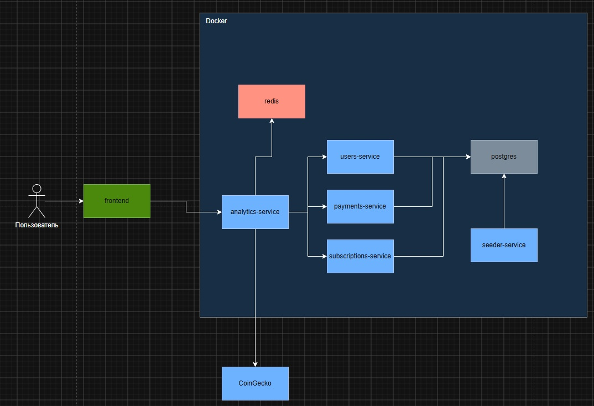
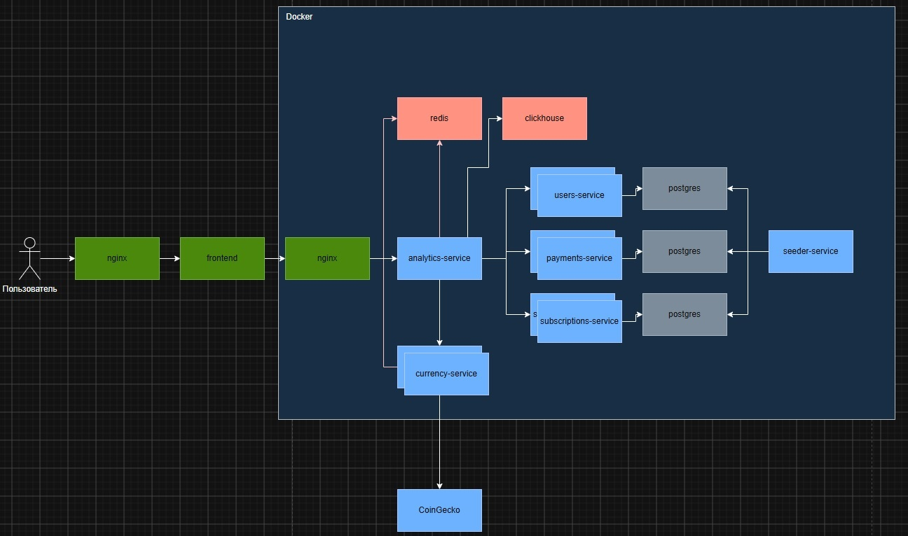

# TestAnalytics — сервис маркетинговой аналитики подписок

Мидлварь-сервис для маркетинга: раз в 10 минут сам опрашивает мок-источники (пользователи, подписки, платежи), считает **LTV** и **проценты продлений по тарифам**, кеширует последний снимок в Redis и отдаёт его по HTTP, не ходя в источники на клиентских запросах.

## Архитектура

Текущая реализация (локальный/тестовый стек, `docker-compose.yaml`):



- **users / payments / subscriptions-service** — моки источников: PostgreSQL (у каждого своя база), миграции goose, пагинация, `updated_since`; через env настраиваются искусственная задержка и доля ответов 500/429;
- **seeder-service** — one-shot генератор согласованных данных: ≥10 000 пользователей, история 18–24 месяца, детерминировано по `SEED`. Гарантии согласованности: сначала генерируется история пользователя (подписки + платежи под цены тарифов), потом батчами пишется в три базы — id и суммы везде одни и те же;
- **analytics-service** — мидлварь: параллельный опрос всех источников (retry, backoff, пагинация; первый опрос при старте; интервал `SYNC_INTERVAL`; инкрементально через `updated_since`), расчёт метрик в памяти и **атомарная публикация снимка** (один ключ в Redis), HTTP API на `gorilla/mux`;
- **frontend** — React/Vite/Tailwind дашборд, проксирует `/api` на analytics;
- наружу публикуются только **8004** (analytics) и **5173** (frontend), моки — только во внутренней Docker-сети.

Как это выглядело бы в продакшене (видение, `images/prod.jpg`: nginx перед фронтом/бэкендом, горизонтально масштабированные моки со своими базами, ClickHouse для истории снимков метрик, выделенный currency-service):



## API

| Эндпоинт | Что отдаёт |
|---|---|
| `GET /metrics/ltv/summary?from=&to=` | среднее, медиана, общая выручка, число пользователей когорты |
| `GET /metrics/ltv/by-plan?from=&to=` | средний LTV, пользователи и выручка по тарифу первой подписки |
| `GET /metrics/retention?plan_id=&from=&to=&max_periods=12` | продления по периодам: `eligible`, `renewed`, условная `rate`, кумулятивная `cumulative_rate` |
| `GET /users/by-telegram/{telegram_id}/ltv` | LTV пользователя, тариф первой подписки, число платежей, текущий статус подписки (бонус) |
| `GET /currency` | курсы USDT/SOL к рублю через CoinGecko (бонус: конвертация отображения) |
| `GET /status` | время последнего успешного опроса, следующий опрос, последняя ошибка синхронизации |
| `GET /healthz` | liveness |
| `GET /swagger` | OpenAPI (аннотации хендлеров) |

`from`/`to` фильтруют когорту по дате первой подписки. В каждом ответе метрик есть `data_as_of` — время снимка. Пока снимка нет — `503` + `Retry-After`. За счёт `ETag`/`Last-Modified` клиент получает `304`, `Cache-Control: max-age` равен времени до следующего опроса (но не больше 600 секунд).

## Кеширование и отказоустойчивость

- после **успешного** опроса метрики пересчитываются и публикуются одним ключом — атомарно; частично загруженный снимок не публикуется никогда;
- ошибка источника (после всех ретраев) кеш не трогает — клиенты продолжают получать последние данные, причина видна в `/status`;
- ответы с `from`/`to` считаются из текущего снимка и кешируются до следующего обновления; одновременные одинаковые запросы объединяются через `singleflight` — параллельного пересчёта нет;
- конкурентный доступ: read-методы хранилищ возвращают копии, это покрыто race-тестами.

## Метрики и допущения по расчётам

1. **LTV пользователя** = сумма платежей со статусом `succeeded`. Возврат — это смена статуса того же платежа на `refunded` (отдельных строк «возврата» в данных нет), его нетто-вклад в LTV равен нулю: платёж был успешным, но затем возвращён.
2. **LTV по тарифу** — группировка по тарифу **первой подписки** пользователя; выручка с других тарифов после смены остаётся в исходной когорте.
3. **Среднее/медиана** считаются по всем пользователям когорты — те, кто ни разу не оплатил, учтены нулём.
4. **Retenшн** строится по покрытию подписками «календаря первого тарифа»:
   - период N — интервал `[start₀ + (N−1)·period_months(первого плана)·30д, start₀ + N·…)`; месяц = 30 дней — так же, как генерируются периоды в данных;
   - «дошёл до периода N» — подписками пользователя покрыта середина периода N; «продлил после N» — покрыт период N+1;
   - период отдаётся в ответе, только если он уже закончился (`period_end ≤ data_as_of`) — требование задания про занижение метрики;
   - смена тарифа считается продолжением (пользователь продолжил пользоваться продуктом); переподписка после длительного оттока продлением не считается; ранняя покупка вперёд (перекрытие периодов) и небольшой гэп — считаются продлением.
5. **Деньги** — `int64` в минорных единицах, без float64. Суммы считаются в одной валюте (RUB); мультивалютность реализована как бонус — конвертация только на стороне отображения.
6. **UUID v4** — упорядоченный по времени id не нужен: инкрементальная синхронизация опирается на `updated_at`/`created_at`, а не на идентификаторы; v4 генерируется без единой точки распределения, коллизии на объёме задания исключены практически.
7. **`plan_id` в ответах** — числовой (`int16`, 1/3/6/12 месяцев). Контракт примера из задания изменён с обоснованием: строка «monthly» не даёт маркетингу ничего, у тарифов есть числовые id из `GET /plans`.

## Запуск локально

Нужен Docker + docker compose v2.

```bash
git clone <repo> && cd test_analytics
docker compose up --build -d --wait
# seeder входит в состав стека и один раз наполняет базы;
# пересоздать данные с другим seed:
SEED=123 FORCE=1 docker compose run --rm seeder
```

- frontend: `http://localhost:5173`
- analytics: `http://localhost:8004` (`/metrics/ltv/summary`, `/status`, `/swagger`)

Частичная локалка (все моки + БД с открытыми портами, без analytics и frontend):

```bash
docker compose -f docker-compose-local.yaml up -d --profile seed
# порты: postgres 5432, redis 6379, subscriptions 8001, users 8002, payments 8003
```

## Конфигурация (env)

| Переменная | Сервис | По умолчанию | Смысл |
|---|---|---|---|
| `SYNC_INTERVAL` | analytics | `10m` | период опроса источников |
| `SYNC_USERS_URL`, `SYNC_PAYMENTS_URL`, `SYNC_SUBSCRIPTIONS_URL` | analytics | имена контейнеров | адреса моков |
| `REDIS_ADDRESS` | analytics | `redis:6379` | Redis для снимка |
| `CURRENCY_COINGECKO_URL` | analytics | CoinGecko | откуда брать курсы |
| `ANALYTICS_PORT`, `ANALYTICS_ADDRESS` | analytics | `80`, `0.0.0.0` | порт/адрес HTTP |
| `SEED`, `SEED_USERS`, `SEED_BATCH_SIZE`, `FORCE` | seeder | `42`, `10000`, `500`, `0` | детерминизм и объём генерации |
| `MOCK_DELAY`, `MOCK_DELAY_JITTER`, `MOCK_ERROR_RATE_500`, `MOCK_ERROR_RATE_429` | моки | `0` | поведение «как у реальных сервисов» |
| `POSTGRES_USER`, `POSTGRES_PASSWORD`, `POSTGRES_DB` | postgres/seeder | `postgres` | креды БД |

`.env` для compose не коммитится (см. `.env.example`), секретов в репозитории нет.

## Деплой на тестовый сервер

Нужен любой docker с compose v2: Dockerfile'ы не используют BuildKit-специфику, образы собираются и классическим builder'ом.

Ручной деплой:

```bash
# на сервере
git clone <repo> /opt/test_analytics && cd /opt/test_analytics
cp .env.example .env && nano .env   # пароль postgres, seed и т.п.
chmod 600 .env
docker compose up --build -d        # seeder наполнит БД при первом старте
```

Автоматический деплой через CI (`.github/workflows/ci.yml`):

- `lint` — golangci-lint по analytics-service;
- `test` — `go test -race ./...` по analytics-service;
- `compose` — после зелёных проверок, на пуш в `master`/`dev`: раннер пакует репозиторий, передаёт его на тестовый сервер по SSH и выполняет там `docker compose up --build -d` с ожиданием healthcheck'а analytics. Секреты: `SSH_HOST`, `SSH_USER`, `SSH_PASSWORD`, `SSH_PORT` (если не 22), `DEPLOY_DIR` — каталог на сервере с `.env`. Секреты хранятся только в GitHub, в репозиторий не попадают; `.env` на сервере tar-архивом не перезаписывается.

`golangci-lint` локально (конфиг `backend/analytics-service/.golangci.yml`, схема v2):

```bash
docker run --rm --entrypoint golangci-lint -v "$(pwd):/workspace" \
  -w /workspace/backend/analytics-service golangci/golangci-lint:latest run ./...
```

## Тесты

`backend/analytics-service` — фикстуры с вручную посчитанными ожиданиями: LTV (включая возвраты), медиана на неполной когорте, retenшн (смена тарифа, незаконченные периоды, гэпы/ранние покупки, `max_periods`), by-plan; плюс конкурентные тесты хранилищ и singleflight.

```bash
cd backend/analytics-service
go test ./...                    # быстро, локально
# -race (нужен CGO/gcc; на Linux/CI — просто go test -race ./...):
docker run --rm -v "$(pwd)/..:/workspace" -w /workspace/analytics-service \
  golang:1.27-alpine sh -c "apk add build-base >/dev/null && CGO_ENABLED=1 go test -race ./..."
```

## Как использовался ИИ

ИИ-ассистент (OpCode/Claude) применялся для рутины: swagger-аннотации, скелеты Dockerfile/compose, фронтенд-виджеты, перебор вариантов CI-пайплайна и разбора race-детектора. Расчёты метрик проверялись вручную: ретеншн-фикстуры посчитаны руками и сверены с «живым» выводом на 10k-датасете; формула LTV сопоставлена с прямыми SQL-подсчётами по данным. Архитектурные решения (семантика ретеншена, атомарный снимок, кеширование) зафиксированы как допущения в этом README.

## Что сделал бы иначе в продакшене

- **ClickHouse для истории снимков** — хранить все снимки метрик по дням (видение на prod-схеме): распределённые по времени когорты, а не только последний слепок в Redis;
- **событийная доставка вместо опроса** — outbox/CDC из источников (Kafka/Debezium), analytics подписан на события: меньше лага, нет нагрузки на источники поллингом;
- **nginx + TLS** перед фронтом и API, rate limiting, отдельный контур для админского доступа (см. prod-схему);
- **горизонтальное масштабирование** — моки stateless, каждый со своей базой и репликами; analytics — read-only HTTP за балансировщиком;
- **наблюдаемость** — Prometheus + Grafana, централизованные структурированные логи (Loki), алерты «снимок не обновлялся N интервалов»;
- **секреты** — Vault/SSM вместо `.env` на сервере;
- **релизы** — canary/blue-green вместо простой замены через compose; миграции БД отдельным шагом деплоя, а не при старте сервиса;
- **инкрементальные агрегаты** — сейчас метрики пересчитываются с нуля на каждый синк; при росте объёма данных считать только дельту по `updated_since`.
